  

<h1 align="center">
  
</h1>

## 🎓 Sobre mí

Soy estudiante de **Ingeniería de Sistemas y Computación** en la **Universidad Nacional de Colombia**, con enfoque en **inteligencia artificial** y **desarrollo full-stack**.

- 🌱 Aprendiendo actualmente: **Docker**, **Kubernetes** y **Singular**
- 🔭 En el radar: **Rust** y **MongoDB**
- 🎮 Me gustan los RPG, los Souls, los metroidvanias y los roguelikes (25 platinos en Steam)
- 🎹 Toco piano y soy aficionado al speedcubing
- 🎧 Escucho J-rock, jazz y math/indie rock

## 🧭 Qué me interesa

Algoritmos y optimización · Inteligencia artificial · Teoría de la computación · Ciberseguridad · Diseño de sistemas · Desarrollo de videojuegos

## 🛠️ Habilidades

#### Lenguajes y motores
        

#### Frameworks
  

#### Bases de datos
   

#### Herramientas
    

## 🚀 Proyectos

Muchos de mis proyectos viven por ahora en repositorios privados. Mientras organizo y publico los mejores, puedes ver lo que tengo público en mis repositorios fijados. 🔧

## 🏆 Educación y logros

- 📚 Ingeniería de Sistemas y Computación, **Universidad Nacional de Colombia** (7.º semestre, promedio ponderado 4.6)
- 🕹️ Participante en la **GameJam de 24 horas** de la Universidad de los Andes, con EA

## 🤝 Contacto

  <picture>
    <source media="(prefers-color-scheme: dark)" srcset="https://raw.githubusercontent.com/Skylethx/Skylethx/output/pacman-contribution-graph-dark.svg" />
    
  </picture>

<!-- Si la imagen no carga tras la primera ejecución del workflow, revisa en la rama "output" cómo se llaman los .svg generados y ajusta las dos rutas de arriba -->

 

  <i>“I'm enjoying the uselessness of today, and readying my usefulness for tomorrow.”</i>

  

